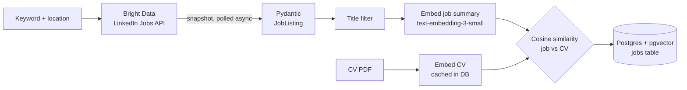

# Kim — Job Search Agent

Kim searches LinkedIn for new job postings, compares each one with my CV using **semantic embeddings**, and stores everything in **Postgres + pgvector** with a match score, so I only look at the jobs that actually fit my profile.

## How it works



1. **Search:** triggers a LinkedIn Jobs dataset on Bright Data for a keyword and location, then polls the snapshot asynchronously (`httpx` + `asyncio`) until the results are ready.
2. **Parse and filter:** each raw result is validated into a typed `JobListing` (Pydantic), and titles containing excluded terms are dropped.
3. **Embed the CV:** the CV PDF is loaded with `PyPDFLoader` and embedded once with OpenAI `text-embedding-3-small`. The vector is cached in the `cv-embeddings` table, so it isn't paid for again on later runs.
4. **Score:** every new job summary is embedded and compared with the CV via cosine similarity. Jobs above `0.7` are marked as a match (`not applied`).
5. **Store:** jobs are deduplicated by LinkedIn posting ID and saved with their embedding, score and status, ready for vector queries later.

## Tech stack

| Layer | Tools |
|---|---|
| Data source | Bright Data LinkedIn Jobs API |
| HTTP / async | httpx, asyncio |
| Validation | Pydantic v2 |
| Embeddings | OpenAI `text-embedding-3-small` via LangChain |
| Storage | PostgreSQL, pgvector, SQLAlchemy |
| CV parsing | LangChain `PyPDFLoader` |

## Project structure

```
main.py          # entry point: search → embed CV → score and save jobs
searchJobs.py    # Bright Data trigger, async snapshot polling, title filter
repository.py    # CV embedding cache and job scoring and persistence
database.py      # SQLAlchemy models (jobs, cv-embeddings) and pgvector setup
utils.py         # PDF text extraction and OpenAI embeddings
schemas/         # Pydantic JobListing model
```

## Running it

**Requirements:** Python 3.12, a Postgres database with the [pgvector](https://github.com/pgvector/pgvector) extension available, a Bright Data account with the LinkedIn Jobs dataset, and an OpenAI API key.

Start Postgres with pgvector using Docker:

```bash
docker run -d --name kim-db -p 5432:5432 \
  -e POSTGRES_PASSWORD=postgres -e POSTGRES_DB=kim \
  pgvector/pgvector:pg16
```

Install and configure:

```bash
python3 -m venv .venv
.venv/bin/pip install -r requirements.txt
cp .env.example .env        # fill in your keys
mkdir curriculo             # put your CV PDF here
```

Set the CV file name and search keyword in `main.py`, then run:

```bash
.venv/bin/python main.py
```

The tables and the `vector` extension are created automatically on the first run. The Bright Data snapshot usually takes a few minutes, and progress is printed while it polls.

## Roadmap

- [ ] Agent layer: let an LLM explain *why* a job matches and draft a tailored cover letter
- [ ] Schedule daily runs and send new matches by email or Telegram
- [ ] Tune the similarity threshold with a small labelled set of jobs (precision/recall)
- [ ] Store the score as a float (the column is currently `Integer`, so it gets truncated)
- [ ] Handle runs that return no jobs in `main.py`
- [ ] Move keyword, location and CV path to CLI arguments
